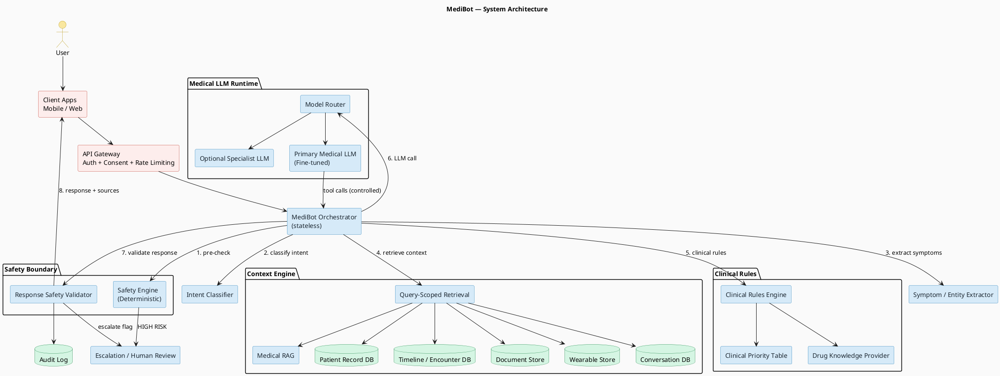
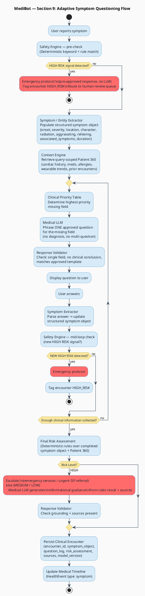
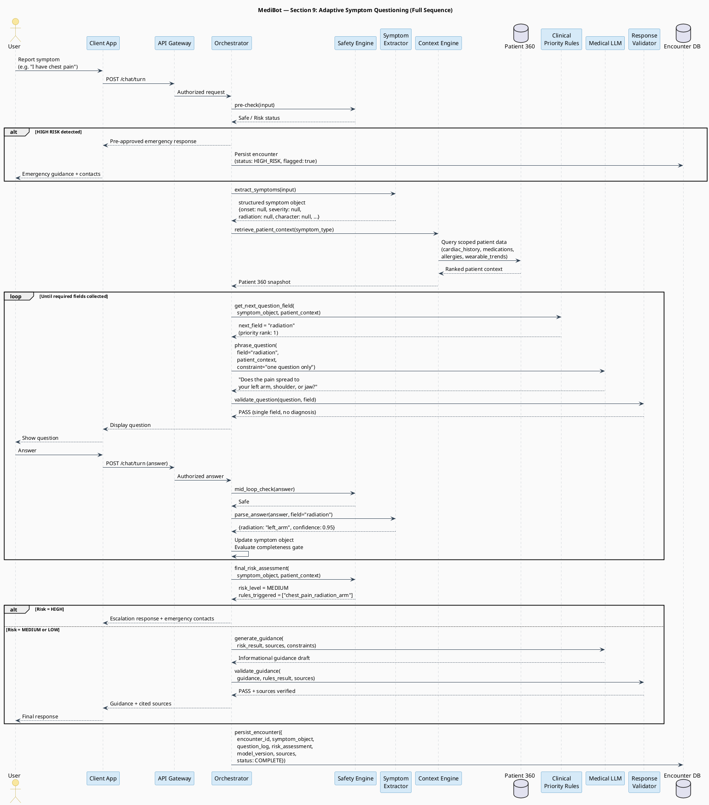
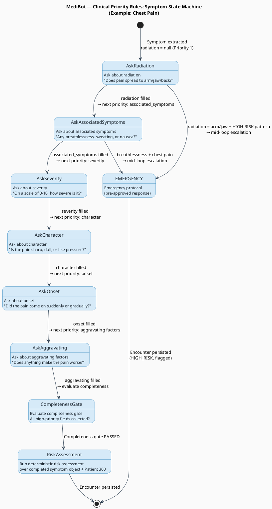
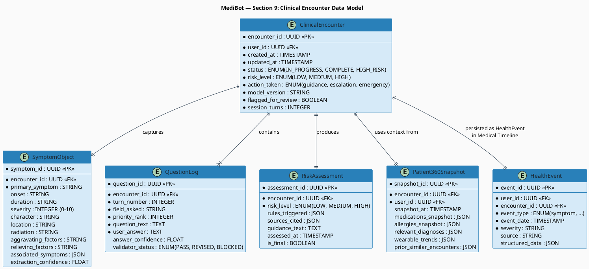
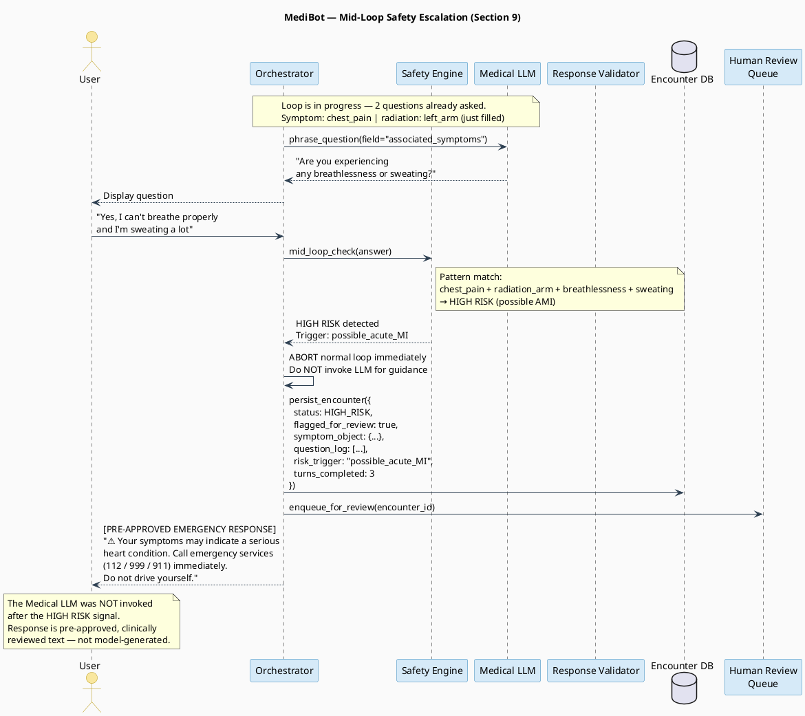

# MediBot — Section 9: PlantUML Diagram Source Code
## Symptom Assessment & Adaptive Questioning

Paste each block into **[plantuml.com/plantuml](https://www.plantuml.com/plantuml/uml/)** or render locally with the PlantUML JAR.

---

## Diagram 1 — Overall System Architecture (Component Diagram)

> Shows all major MediBot components with the Safety Engine, Orchestrator, Medical LLM, Context Engine, and data stores. Highlights the Safety boundary.

---

## Diagram 2 — Adaptive Symptom Questioning Activity Flow

> Shows the step-by-step activity flow from user symptom report to encounter persistence. Includes the mid-loop safety check and the termination condition.

---

## Diagram 3 — Full Adaptive Questioning Sequence Diagram

> Shows all 10 components interacting across the complete symptom loop. Includes the safety alt block, the adaptive loop, and encounter persistence.

---

## Diagram 4 — Clinical Priority Rules State Machine

> Shows how the symptom object transitions through states as fields are filled, driven by the clinical priority table. Each state represents the "current highest-priority missing field".

---

## Diagram 5 — Encounter Persistence Entity-Relationship Diagram

> Shows the data model produced by every completed symptom session — the clinical encounter record and its related entities.

---

## Diagram 6 — Mid-Loop Safety Escalation Sequence

> Shows exactly what happens when a HIGH RISK signal is detected mid-conversation during the adaptive questioning loop.

---

## Quick Render Guide

| Tool | How to Use |
|---|---|
| **Online (easiest)** | Go to [plantuml.com/plantuml/uml](https://www.plantuml.com/plantuml/uml/) → paste any block above |
| **VS Code** | Install *PlantUML* extension by jebbs → preview with `Alt+D` |
| **IntelliJ / PyCharm** | PlantUML Integration plugin → right-click `.puml` file → Preview |
| **Command line** | `java -jar plantuml.jar yourfile.puml` |
| **Export format** | Use `-tpng`, `-tsvg`, or `-tpdf` flag for the JAR |

> **Tip:** Save each `@startuml ... @enduml` block as a `.puml` file (e.g. `medibot_section9_flow.puml`) for version control.
