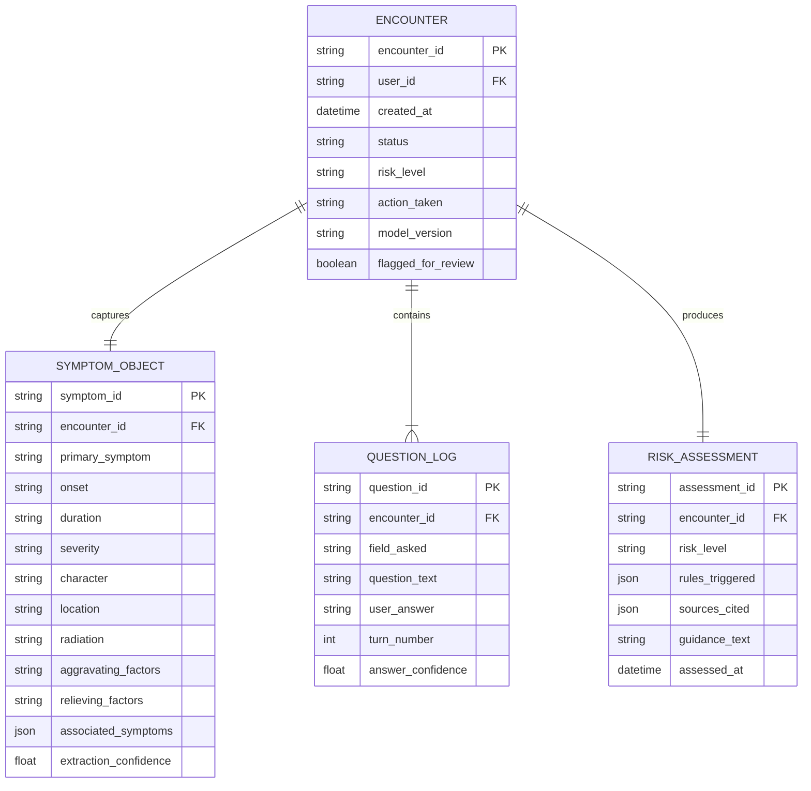

# MediBot — Symptom Assessment & Adaptive Questioning
## Technical & Managerial Report · Section 9 Deep-Dive
**Document version:** 1.0 · **Prepared for:** Engineering Manager Review  
**Status:** Ready for Review

---

## Executive Overview

Section 9 — *Symptom Assessment & Adaptive Questioning* — is the **most clinically sensitive and user-facing loop** in MediBot. Every other module (Patient 360, Document Intelligence, Medication Safety, RAG) feeds into this module, making it the **central nervous system** of the conversational experience.

Rather than responding to a symptom report with a single-shot LLM answer, MediBot treats symptom intake as a **structured clinical interview** — the same methodology a triage nurse uses. The system extracts structured symptom objects, identifies which clinically important fields are still missing, asks **one precisely-prioritised question per turn**, updates the state, and only proceeds to risk assessment when enough information exists to make a safe and useful judgment.

> [!IMPORTANT]
> This module is the primary reason MediBot is more than a medical chatbot. Without it, the system would give generic responses. With it, every conversation produces a structured, auditable clinical encounter record.

---

## 1. The Problem This Solves

### 1.1 What a Generic Chatbot Does
A standard LLM, given "I have chest pain", will:
- Produce a generic paragraph listing possible causes
- Ask no follow-up questions in a structured way
- Retain no structured state between turns
- Produce no auditable clinical record

### 1.2 What MediBot's Adaptive Questioning Does
MediBot, given "I have chest pain", will:
1. **Immediately run a safety pre-check** — does this description contain HIGH RISK signals (radiating pain + breathlessness)? If yes → emergency protocol, no LLM reasoning invoked.
2. **Extract a structured symptom object** with fields like `onset`, `severity`, `location`, `character`, `radiation`, `aggravating_factors`, `relieving_factors`, `associated_symptoms`, `duration`.
3. **Retrieve query-scoped Patient 360** — the patient's cardiac history, current medications, age/sex, allergies, wearable HR/SpO₂ trends.
4. **Apply the clinical priority table** — a deterministic rules engine decides which missing field is most important to gather *right now* (e.g., radiation pattern is highest priority for chest pain).
5. **The Medical LLM phrases one approved question** — it does not decide *what* to ask, only *how* to say it naturally in context.
6. Loop until enough fields are collected, then run final risk assessment → guidance or escalation → persist the encounter.

---

## 2. The Full Pipeline — Step by Step

````carousel
### Step 1 — User Reports Symptom
The user sends a message like *"I have been having chest pain since this morning."*

The Orchestrator receives the message via the API Gateway (after auth + consent gates). This triggers the symptom pathway.

**Key design rule:** The LLM does NOT see this message first. The Safety Engine sees it first.

<!-- slide -->
### Step 2 — Safety Pre-Check (Deterministic, Not LLM)

The Safety Engine applies a **deterministic pattern-match and keyword-rule system** over the raw input:

| Signal | Action |
|---|---|
| Chest pain + breathlessness | HIGH RISK → Emergency protocol |
| Suicidal ideation keywords | HIGH RISK → Emergency protocol |
| Stroke indicators (FAST) | HIGH RISK → Emergency protocol |
| Severe bleeding description | HIGH RISK → Emergency protocol |
| All others | Continue to normal symptom flow |

> [!CAUTION]
> If HIGH RISK is detected, the Medical LLM is **never invoked**. A pre-approved, clinically reviewed emergency response is returned immediately. The encounter is tagged `HIGH_RISK` and routed to human review.

<!-- slide -->
### Step 3 — Symptom Extraction (Structured Object)

The Symptom Extractor (a fine-tuned NER/extraction model or the Medical LLM in extraction mode) parses the user's description into a structured object:

```json
{
  "symptom_id": "sym_abc123",
  "primary": "chest_pain",
  "onset": "this_morning",
  "duration": "~6h",
  "severity": null,
  "character": null,
  "location": "chest",
  "radiation": null,
  "aggravating_factors": null,
  "relieving_factors": null,
  "associated_symptoms": [],
  "context_flags": ["first_report", "no_prior_cardiac_history_confirmed"]
}
```

Every `null` field is a candidate for adaptive questioning. The **priority order** of which nulls to fill is NOT decided here — that's the clinical priority table's job.

<!-- slide -->
### Step 4 — Retrieve Query-Scoped Patient 360

The Context Engine retrieves **only the patient context relevant to this symptom**. It does NOT dump the entire medical history into the prompt.

For a chest pain report, it retrieves:
- Recent cardiac history / diagnoses
- Current medications (especially cardiac, anticoagulants)
- Known allergies
- Most recent wearable HR, SpO₂, HRV trends (last 24–72h)
- Prior symptom encounters involving chest pain
- Age, sex, pregnancy status if relevant

**Relevance scoring formula:**
```
relevance_score =
    query_relevance       (is this data related to chest pain?)
  + clinical_importance   (is this a high-stakes data type?)
  + recency               (how recent is this data?)
  + reliability           (document confidence score)
  + source_quality        (lab vs. self-reported vs. wearable)
```

<!-- slide -->
### Step 5 — Clinical Priority Table (Deterministic Rules)

The **most important architectural decision in this module**: the system uses an explicit clinical priority table to decide which missing field to ask about next. This is **not delegated to the LLM**.

Example table for chest pain:

| Priority | Missing Field | Clinical Reason |
|---|---|---|
| 1 | `radiation` | Radiation to arm/jaw is a key AMI indicator |
| 2 | `associated_symptoms` (breathlessness) | Cardiac vs. musculoskeletal differentiator |
| 3 | `severity` (0–10) | Triage urgency |
| 4 | `character` (sharp/dull/pressure) | Pleuritic vs. cardiac vs. GERD |
| 5 | `onset` (sudden/gradual) | Aortic dissection vs. angina |
| 6 | `aggravating_factors` | Exertional vs. positional vs. rest pain |
| 7 | `relieving_factors` | Nitrate response, rest response |

The rules engine returns: **"Ask about radiation next."**

<!-- slide -->
### Step 6 — Medical LLM Phrases ONE Approved Question

The LLM's role here is **strictly communicative, not clinical**. It receives:
- The field that needs to be asked (`radiation`)
- The patient context (age, tone preferences, prior conversation)
- A constraint: ask about this field only, do not ask multiple questions

The LLM outputs a natural-language question such as:
> *"Does the pain spread to your left arm, shoulder, jaw, or back?"*

The **Response Validator** then checks:
- Does the question ask about only one field?
- Does it avoid giving a diagnosis or medical conclusion?
- Does it match the approved question template for this field?

<!-- slide -->
### Step 7 — User Answers → Update Structured State

The user's answer is fed back to the Symptom Extractor to parse the answer into the structured object:

```json
{
  "radiation": "yes — left_arm",
  "radiation_confidence": 0.95
}
```

The symptom state object is updated. The `radiation` field is now populated.

The Clinical Priority Rules are consulted again. `associated_symptoms` is now the highest-priority missing field.

The loop continues.

<!-- slide -->
### Step 8 — Termination & Risk Assessment

The loop terminates when one of these conditions is met:
- All high-priority fields are populated (completeness gate)
- The system determines enough information exists for a reliable risk assessment
- A mid-loop HIGH RISK signal is detected → escalate immediately

**Final risk assessment** runs deterministically over the completed symptom object + Patient 360 + clinical rules:

| Completed Symptom Pattern | Risk Level | Action |
|---|---|---|
| Chest pain + radiation to arm + breathlessness | HIGH | Escalate + emergency |
| Chest pain + pleuritic character + fever | MEDIUM | Urgent GP referral guidance |
| Chest pain + positional + young patient | LOW-MEDIUM | Musculoskeletal guidance + follow-up |

<!-- slide -->
### Step 9 — Persist Clinical Encounter

Every completed symptom loop produces a **persisted Clinical Encounter record**:

```json
{
  "encounter_id": "enc_xyz789",
  "user_id": "usr_001",
  "timestamp": "2026-09-20T17:30:00Z",
  "symptom_object": { ... },
  "patient_360_snapshot": { ... },
  "questions_asked": [...],
  "answers_received": [...],
  "risk_assessment_result": "MEDIUM",
  "action_taken": "informational_guidance",
  "guidance_text": "...",
  "sources": ["NICE CG95", "BHF chest pain guidelines"],
  "model_version": "MediBot-LLM-v2.1",
  "encounter_status": "COMPLETE",
  "flagged_for_review": false
}
```

This record feeds the longitudinal Medical Timeline, future context retrieval, and clinical audit.
````

---

## 3. System Diagram

### 3.1 Adaptive Questioning Activity Flow


### 3.2 Full Sequence Diagram — All Components


### 3.3 MediBot Overall Architecture (Context)


---

## 4. How This Module Improves MediBot — Impact Analysis

This section directly answers the manager's question: *"How does this affect everything?"*

### 4.1 Impact on the Medical LLM (Section 4)

| Without Adaptive Questioning | With Adaptive Questioning |
|---|---|
| LLM receives vague symptom prompt, hallucinates diagnosis | LLM receives a **completed structured symptom object** + scoped Patient 360 |
| LLM chooses what to ask next (unpredictable) | LLM **only phrases** an approved question — deterministic what, natural how |
| Fine-tuning is harder (no clear task boundary) | Fine-tuning has a clear task: *question phrasing under constraints* |
| High hallucination risk on clinical conclusions | Risk reduced: LLM explains a **rules-engine result**, not its own judgment |

> [!TIP]
> The adaptive questioning pipeline gives the LLM a **bounded, well-defined role** at each step. This dramatically improves fine-tuning effectiveness and safety.

### 4.2 Impact on Patient 360 (Section 5)

- Every completed encounter **writes back** to the Patient 360 Medical Timeline as a `HealthEvent` of type `symptom`.
- Future encounters retrieve prior symptom history: *"You reported chest pain 3 months ago — did it resolve?"*
- Symptom trends become **longitudinal signals**: recurring headaches, escalating breathlessness severity.
- Patient 360 becomes richer with every interaction, making future context retrieval more relevant.

### 4.3 Impact on Clinical Context & Retrieval Engine (Section 8)

- Query-scoped retrieval is only possible because the symptom is **structured** (we know to retrieve cardiac history for `chest_pain`, not the patient's full allergy list).
- The relevance scorer becomes **more precise**: it can filter by `symptom_type`, `body_system`, `patient_risk_profile`.
- Without structured symptom objects, the Context Engine would have to retrieve a broad/generic context window, increasing noise and hallucination risk.

### 4.4 Impact on Medication Intelligence (Section 11)

- If a symptom assessment reveals a potential drug side effect (e.g., "I started a new medication and now have heart palpitations"), the symptom object is passed directly to the Medication Intelligence module.
- The Clinical Rules Engine can cross-reference current medications against the symptom pattern.
- The adaptive loop can include a question like *"When did you last take your Metoprolol?"* — driven by the clinical priority table, not the LLM.

### 4.5 Impact on Clinical Safety & Escalation (Section 12)

- Every turn of the symptom loop runs through the Safety Engine — not just the first message.
- A mid-loop escalation trigger (e.g., user reveals new symptom of breathlessness during follow-up) immediately redirects to the emergency protocol.
- The persisted encounter, tagged `HIGH_RISK`, is routed to the human review queue with the full structured symptom object — making the human reviewer's job faster and more accurate.

### 4.6 Impact on Clinical Governance & Audit (Section 20)

- Every encounter record provides a **full audit trail**: what was asked, what was answered, what risk was assessed, which model version was used, which sources were cited.
- Clinical advisors can review the question-priority table periodically and update it as guidelines change — without retraining the LLM.
- Anomalies (e.g., the LLM asked a question outside its template set) are detectable via the Response Validator logs.

---

## 5. Benefits — Manager-Level Summary

### 5.1 Clinical Benefits

| Benefit | Explanation |
|---|---|
| **Safer triage** | Safety pre-check is deterministic — no LLM path for HIGH RISK inputs |
| **Clinically complete encounters** | Structured symptom objects capture all important OPQRST-A fields, not just what the user volunteers |
| **Reduced hallucination** | LLM role is bounded to question phrasing and explanation — not clinical judgment |
| **Longitudinal memory** | Every encounter enriches the Medical Timeline for future relevance |
| **Explainable decisions** | Risk assessment is driven by explicit clinical rules, not opaque model outputs |

### 5.2 Product Benefits

| Benefit | Explanation |
|---|---|
| **Superior UX** | One focused question per turn — feels like speaking to a knowledgeable nurse |
| **Higher user trust** | Users see the system understands context (e.g., it knows their medications) |
| **Differentiation** | No generic chatbot does this — MediBot becomes a clinical-grade assistant |
| **Proactive follow-up** | Persisted encounters enable *"Last week you reported chest pain — how are you feeling now?"* |

### 5.3 Engineering Benefits

| Benefit | Explanation |
|---|---|
| **Modular architecture** | Clinical priority table is a separate data file — updated by clinicians, not engineers |
| **Testable pipeline** | Each step is deterministic and unit-testable (extraction, priority selection, risk assessment) |
| **LLM separation of concerns** | The LLM only does what it's good at: natural language phrasing |
| **Auditability** | Every structured state transition is logged for debugging and compliance |

### 5.4 Business/Regulatory Benefits

| Benefit | Explanation |
|---|---|
| **Audit compliance** | Full encounter records with model version, sources, and decision trail |
| **Clinical sign-off surface** | Clinical advisors review the priority table and risk thresholds — not the entire model |
| **Rollback safety** | Changing the clinical priority table does not require retraining the LLM |
| **Regulatory defensibility** | Decisions are traceable to explicit rules, not black-box model outputs |

---

## 6. How We Will Build This — Implementation Plan

### Phase 1: Foundation (Weeks 1–4)

- [ ] Define the **Symptom Schema** — structured JSON object with all clinical fields per symptom type (chest pain, headache, abdominal pain, dyspnea, etc.)
- [ ] Build the **Symptom Extractor** — NER pipeline (spaCy/fine-tuned BERT or Medical LLM in extraction mode) that populates the structured object from free text
- [ ] Define the **Clinical Priority Table v1** — explicit rules per symptom type, reviewed by clinical advisor
- [ ] Write the **priority ranking algorithm** — given a partially filled symptom object, return the highest-priority missing field

### Phase 2: Loop Implementation (Weeks 5–8)

- [ ] Implement the **Safety Pre-Check** module with HIGH RISK keyword/rule set (clinically reviewed)
- [ ] Integrate **Patient 360 query-scoped retrieval** for the symptom context (build relevance filters per symptom type)
- [ ] Implement the **question phrasing prompt template** for the Medical LLM — constrained to one field, one question, no diagnosis
- [ ] Implement the **Response Validator** for question output — checks constraint compliance
- [ ] Build the **state update loop** — parse user answer, update symptom object, re-evaluate priority

### Phase 3: Risk Assessment & Escalation (Weeks 9–11)

- [ ] Implement the **final risk assessment rules engine** — maps completed symptom object → risk level
- [ ] Integrate with **Clinical Safety & Escalation** module (Section 12)
- [ ] Implement **informational guidance generation** — LLM generates explanation from rules result + sources
- [ ] Implement **Encounter Persistence** — write structured encounter to the Timeline DB

### Phase 4: Clinical Review & Testing (Weeks 12–14)

- [ ] Clinical advisor review of: priority table, safety thresholds, risk assessment rules, emergency triggers
- [ ] Unit tests for: extractor, priority algorithm, state machine, risk assessment
- [ ] Integration tests for: full symptom loop end-to-end, mid-loop escalation, encounter persistence
- [ ] Evaluation dataset: 200+ labeled symptom conversations (structured output validation)

---

## 7. Data Architecture — The Encounter Record

Every symptom session produces a persisted **Clinical Encounter** record. This is the output that your manager described as the **crucial part** of this module.



---

## 8. Key Design Principles & Why They Matter

> [!NOTE]
> These design principles are what separates MediBot from a chatbot with medical knowledge.

| Principle | Implementation | Why It Matters |
|---|---|---|
| **Safety before LLM** | Safety Engine runs before any LLM invocation | No hallucinated emergency response |
| **Structured state, not conversation memory** | JSON symptom object updated each turn | State is auditable, queryable, persistent |
| **Deterministic priority** | Clinical priority table (not LLM) decides what to ask | Consistent, clinically defensible questioning order |
| **LLM phrases, not decides** | LLM receives "ask about radiation" — outputs natural question | Bounded LLM role, controllable output |
| **One question per turn** | Response Validator enforces this | Reduces cognitive load, better UX |
| **Mid-loop safety gates** | Safety re-evaluated after each user answer | New HIGH RISK signals caught immediately |
| **Full encounter persistence** | Every interaction → structured audit record | Regulatory compliance, longitudinal care |

---

## 9. Risks & Mitigations

| Risk | Likelihood | Impact | Mitigation |
|---|---|---|---|
| Clinical priority table is incomplete for rare symptoms | Medium | High | Version-controlled table with clinical advisor sign-off cycle; fallback to general OPQRST ordering |
| LLM rephrases question in a way that introduces a diagnosis hint | Medium | High | Response Validator checks against approved template set; red-team testing |
| User gives ambiguous answer that extractor mis-parses | High | Medium | Confidence threshold: below 0.7 confidence → ask for clarification (another structured turn) |
| Mid-loop state loss (session timeout, crash) | Medium | Medium | Encounter state persisted to DB after every turn, not just at completion |
| Safety pre-check keyword match has false negatives | Low-Medium | Critical | Layered approach: keyword rules + pattern match + wearable alert integration; Safety Engine is reviewed quarterly |
| Encounter data breach (sensitive symptom data) | Low | Critical | PHI encryption at rest and in transit; encounter data governed under the same consent/RBAC as Patient 360 |

---

## 10. Success Metrics

| Metric | Target | Measurement Method |
|---|---|---|
| **Encounter completion rate** | > 80% of started symptom sessions produce a complete encounter | Encounter DB analytics |
| **Average turns to completion** | < 6 turns for standard symptom profiles | Question log aggregation |
| **Safety pre-check false negative rate** | 0% for known HIGH RISK patterns | Quarterly red-team evaluation |
| **LLM question constraint compliance** | > 99% (Response Validator pass rate) | Validator logs |
| **Risk assessment accuracy** | > 90% alignment with clinical advisor review on test set | Manual clinical audit |
| **Encounter persistence reliability** | 99.9% of completed loops produce a persisted record | DB monitoring |
| **User-reported UX satisfaction** | > 4/5 on "Did the conversation feel helpful?" | In-app feedback |

---

## 11. Why This Is the "Crucial Part" — Manager Summary

Your manager is right to call this module crucial. Here is why, in three sentences:

1. **Every other module exists to support this loop.** Patient 360 is retrieved for it. RAG is retrieved for it. Medication checks are triggered by it. Document intelligence feeds into it. Without this structured loop, all those subsystems have no coherent purpose in a user conversation.

2. **This is where clinical safety is most exposed.** A user reporting symptoms is the highest-risk moment in the entire product. A wrong answer, a missed escalation, or a hallucinated diagnosis here is the most likely path to a serious adverse event. The adaptive questioning architecture — with its deterministic safety gate, structured state, explicit priority rules, and bounded LLM role — is specifically engineered to prevent that.

3. **This is what produces the data asset.** Every completed encounter is a structured, sourced, version-tracked clinical record. Over time, this data enables longitudinal health insights, proactive alerts, model fine-tuning, and clinical audit — making MediBot more valuable with every conversation.

---

*Report prepared for MediBot Section 9 — Symptom Assessment & Adaptive Questioning*  
*Version 1.0 · September 2026*
